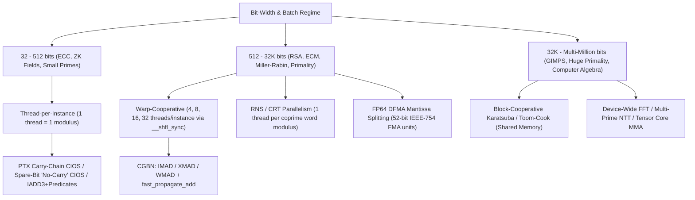

# GPU Arbitrary-Precision Arithmetic & Montgomery Multiplication: Dissertations and High-Performance Literature

## 1. Identifying the ~2010 "200+ Page Dissertation"

Several doctoral dissertations (and one canonical monograph) from the 2010 era match some or all of your description depending on whether the memory is anchored to the **exact 2010 date & 200+ page count**, to **CGBN's author (whose GPU big-int series began in 2010)**, or to **computational number theory (`gmp-ecm`)**:

| Candidate | Year | Length | GPU? | Focus & Direct Link |
| :--- | :---: | :---: | :---: | :--- |
| **Owen Harrison** (*Acceleration of Cryptographic Functions using Graphics Hardware*, Ph.D. Thesis, Trinity College Dublin, `TCD-CS-2010-02`, advisor John Waldron) | **Feb 2010** | **214 pp.** | **Yes (CUDA / DX10)** | **Exact 2010 + 200+ page GPU match.** Covers GPU execution/memory models, modular arithmetic & Montgomery reduction fundamentals (Sec. 2.4), and a full chapter (Ch. 6, pp. 121–146) benchmarking serial vs. parallel $N \times N$ limb radix Montgomery exponentiation against RNS (Kawamura) Montgomery multiplication on CUDA GPUs, plus request batching (Ch. 7). [Direct PDF (TCD)](https://publications.scss.tcd.ie/tech-reports/reports.10/TCD-CS-2010-02.pdf) |
| **Niall D. Emmart** (*A Study of High Performance Multiple Precision Arithmetic on Graphics Processing Units*, Ph.D. Dissertation, UMass Amherst, advisor Charles C. Weems) | **2018** *(papers started **2010**)* | Dissertation | **Yes (CUDA / PTX)** | **Purest technical match (author of CGBN).** Emmart began publishing GPU multiprecision papers in **2010** (*IPDPSW / PPL 2010*); his dissertation unifies GPU big-int `add`/`sub`/`mul`, Strassen multi-FFT multiplication, parallel short division, auto-generated PTX Montgomery exponentiation, `XMAD` warp-cooperative Montgomery, and `FP64` modular multiplication. [UMass ScholarWorks (`hdl:20.500.14394/17353`)](https://hdl.handle.net/20.500.14394/17353) · [DOI `10.7275/11399986.0`](https://doi.org/10.7275/11399986.0) |
| **Thomas Izard** (*Opérateurs Arithmétiques Parallèles pour la Cryptographie Asymétrique*, Ph.D. Thesis, Univ. Montpellier II / LIRMM, advisors P. Giorgi & A. Tisserand) | **Dec 2011** | **~250 pp.** *(French)* | **Yes (CUDA)** | Dedicated entirely to parallel multiprecision & modular arithmetic operators (Montgomery CIOS/FIOS, Barrett, RNS, PMNS, and the `PACE` library) across GPUs and multicore CPUs. [HAL `tel-00685654`](https://theses.hal.science/tel-00685654) |
| **Alexander Kruppa** (*Speeding up Integer Multiplication and Factorization*, Ph.D. Thesis, Univ. Henri Poincaré – Nancy 1 / INRIA, advisor Paul Zimmermann) | **Jan 2010** | **~197 pp.** *(English)* | No *(CPU / SIMD)* | Famous in the `gmp-ecm` / GIMPS ecosystem for Montgomery arithmetic, Schönhage–Strassen / FFT multiplication, and Stage 1/2 ECM optimizations; later extended to GPUs in `gmp-ecm` by Cyril Bouvier. [HAL `tel-01748662`](https://theses.hal.science/tel-01748662) |
| **Pavel Emeliyanenko** (*Harnessing the Power of GPUs for Problems in Real Algebraic Geometry*, Ph.D. Thesis, Saarland Univ. / MPI-INF) | **Nov 2012** | Ph.D. Thesis *(English)* | **Yes (CUDA)** | Deep treatment of GPU modular arithmetic, RNS/CRT reconstruction, Number Theoretic Transforms (NTT), and exact multiprecision polynomial/resultant algorithms. [DOI `10.22028/d291-26404`](https://doi.org/10.22028/d291-26404) |
| **Joppe W. Bos** (*On the Cryptanalysis of Public-Key Cryptography*, Ph.D. Thesis, EPFL `TH5291`, advisor Arjen K. Lenstra) | **Feb 2012** | **152 pp.** *(English)* | **Yes (CUDA & Cell)** | Covers GPU cofactorization/ECM, limb representations, and parallel/vector-friendly Montgomery multiplication variants. [EPFL Infoscience](https://infoscience.epfl.ch/record/170537) |
| **Ruben Niederhagen** (*Parallel Cryptanalysis*, TU Eindhoven, **2012**) & **Peter Schwabe** (*High-Speed Cryptography and Cryptanalysis*, TU Eindhoven, **2011**) | **2011–2012** | **~200+ pp.** *(English)* | **Yes (CUDA / PTX)** | Dutch *Proefschriften* supervised by D. J. Bernstein & T. Lange detailing low-level NVIDIA GPU microarchitecture, PTX/SASS scheduling, and massively parallel finite-field / curve arithmetic. [Schwabe Papers](https://cryptojedi.org/papers/#phd) |

> [!NOTE]
> **Bonus check — 2010 Monograph:** If there is any chance the PDF you recall was a free book preprint rather than a thesis, **Richard P. Brent & Paul Zimmermann's *Modern Computer Arithmetic*** (Cambridge University Press, **2010**, preprint `mca-cup-0.5.9.pdf` at **236 pages**) is the classic 2010 236-page text on arbitrary-precision integer arithmetic, quadratic/subquadratic Montgomery `REDC`, Barrett/Newton division, and FFT/NTT multiplication (though it is hardware-agnostic rather than GPU-specific).

---

## 2. Architectural Taxonomy of GPU Big-Int & Montgomery Design

High-performance GPU arbitrary-precision and Montgomery implementations partition cleanly along two axes: **how limbs map to threads** and **which GPU execution pipe performs the $w \times w$ products**.

### Key Microarchitectural Tradeoffs on NVIDIA GPUs

1. **Thread-per-Instance vs. Warp-Cooperative (`CGBN`):**
   - **Thread-per-instance** avoids inter-thread synchronization completely and reaches peak throughput when an entire Montgomery state ($2s+2$ registers of 32-bit limbs) fits comfortably in a single thread's register file without spilling to local memory (ideal for 256–384-bit curves/fields, up to ~512–1024 bits with transposed coalesced loads).
   - **Warp-cooperative** (pioneered by Emmart et al. and implemented in [`include/cgbn/core/core_mont_imad.cu`](include/cgbn/core/core_mont_imad.cu), [`include/cgbn/core/core_mont_xmad.cu`](include/cgbn/core/core_mont_xmad.cu), and [`include/cgbn/core/core_mont_wmad.cu`](include/cgbn/core/core_mont_wmad.cu)) distributes `LIMBS` 32-bit words across `TPI` $\in \{4, 8, 16, 32\}$ threads. Broadcasts (`__shfl_sync`) and shifts (`__shfl_down_sync`) happen in registers in 1 warp instruction without touching shared memory, preventing register-spill cliffs from 1K up to 32K bits.

2. **Hardware Multiplier Pipes across GPU Generations:**
   - **Tesla/GT200 (`IMAD24`):** Only 24-bit native integer multiplies; early papers used 16-bit or 24/28-bit limbs (`Bernstein et al. 2009`).
   - **Fermi/Kepler (`IMAD` 32-bit):** Native 32-bit `mad.lo.cc.u32` / `madc.hi.cc.u32` PTX carry chains (`Neves & Araújo 2011`).
   - **Maxwell/Pascal (`XMAD` 16-bit):** 32-bit integer multiplies were emulated in microcode via multiple 16-bit `XMAD` ops; `Emmart et al. (ARITH 2016)` restructured modular multiplication into two-pass 16-bit `XMAD` accumulation chains (still visible in [`include/cgbn/core/core_mont_xmad.cu`](include/cgbn/core/core_mont_xmad.cu)).
   - **Volta/Turing/Ampere/Hopper/Blackwell (`WMAD` / wide `IMAD` + `IADD3`):** Dedicated 32-bit integer datapaths returned alongside 3-input `IADD3` with predicate carry registers (`CGBN`'s `wmad` path in [`include/cgbn/core/core_mont_wmad.cu`](include/cgbn/core/core_mont_wmad.cu), and `gECC 2024`).
   - **FP64 `DFMA` Pipe (`DPF`):** On HPC GPUs (V100, A100, H100, B200) where FP64 FMA throughput is 1:2 with FP32, packing 51–52-bit limbs into IEEE-754 `double`s using `fma.rz.f64` / `fma.rn.f64` (`Emmart, Zheng & Weems ARITH 2018`) outperforms integer `IMAD` pipelines.
   - **Tensor Cores (`mma.sync` INT8 / FP16):** Splitting big integers into 8-bit slices or RNS residues frames multi-limb convolution or NTT butterflies as dense matrix products (`TensorFHE 2023`, `DistMSM 2024`, `Sugizaki & Takahashi 2026`).

3. **Montgomery Multiplication & Squaring Variants (`CIOS`, `SOS`, Spare-Bit, and Squaring):**
   - **CIOS vs. SOS:** *Coarsely Integrated Operand Scanning* (CIOS) interleaves multiplication and `REDC` row-by-row, requiring only $s+2$ words of state (`Koç, Acar & Kaliski 1996`). *Separated Operand Scanning* (SOS) computes the full $2s$-word product (or square) first and then applies `REDC`.
   - **The "No-Carry / Spare-Bit" CIOS Optimization:** When the top limb of $N$ has $\ge 2$ unused bits ($N < R/4$ and inputs $< 2N$), intermediate carries in the CIOS inner loop stay bounded within a single extra word without overflowing, eliminating several `addc` instructions per limb (heavily used in modern GPU ZKP libraries like `sppark`, `cuZK`, and Yrrid's ZPrize kernels).
   - **Montgomery Squaring (`mont_sqr`):** Integrated Montgomery squaring (`Guajardo & Paar 1999`) suffers from irregular index symmetry when limbs are distributed across warp lanes. In warp-cooperative designs (such as [`include/cgbn/core/core_mont.cu`](include/cgbn/core/core_mont.cu) and [`include/cgbn/core/core_mont_wmad.cu`](include/cgbn/core/core_mont_wmad.cu)), **SOS-style squaring** — accumulating strictly upper-triangular off-diagonal products ($i < j$), doubling via a 1-bit cross-lane shift, adding $a_i^2$ diagonal terms, and then running a standard $s$-step Montgomery reduction loop — preserves uniform warp-wide `madlo`/`madhi` chains and halves the multiplication count cleanly.

---

## 3. Curated Literature: High-Performance GPU Implementations

### A. Foundational Montgomery & Squaring Algorithms (Essential Pre-GPU Theory)
1. **P. L. Montgomery (1985)**, *"Modular multiplication without trial division,"* *Mathematics of Computation*, 44(170), 519–521. [DOI: `10.1090/S0025-5718-1985-0777282-X`](https://doi.org/10.1090/S0025-5718-1985-0777282-X) — Introduces Montgomery representation and `REDC`.
2. **Ç. K. Koç, T. Acar, & B. S. Kaliski Jr. (1996)**, *"Analyzing and comparing Montgomery multiplication algorithms,"* *IEEE Micro*, 16(3), 26–33. [DOI: `10.1109/40.502403`](https://doi.org/10.1109/40.502403) — Defines **SOS, CIOS, FIOS, FIPS, CIHS**; still the standard nomenclature in every GPU paper.
3. **J. Guajardo & C. Paar (1999)**, *"Modified squaring algorithm,"* Technical Report / *IEEE Trans. Computers* follow-ups (and **S. Kawamura et al., EUROCRYPT 2000**, *"Cox–Rower architecture for fast parallel Montgomery multiplication,"* [DOI: `10.1007/3-540-45539-6_37`](https://doi.org/10.1007/3-540-45539-6_37)) — Core blueprints for Montgomery squaring and RNS Montgomery base extension.
4. **J. W. Bos, P. L. Montgomery, D. Shumow, & G. M. Zaverucha (2014)**, *"Montgomery Multiplication Using Vector Instructions,"* *SAC 2013* (LNCS 8282, pp. 471–489; [IACR ePrint 2013/519](https://eprint.iacr.org/2013/519)) — Reformulates Montgomery reduction to break sequential carry dependencies across SIMD/warp lanes.

### B. First-Wave GPU Modular & Montgomery Arithmetic (2007–2013)
5. **A. Moss, D. Page, & N. P. Smart (2007)**, *"Toward Acceleration of RSA Using 3D Graphics Hardware,"* *IMACC 2007*, LNCS 4887, 364–383. [DOI: `10.1007/978-3-540-77272-9_22`](https://doi.org/10.1007/978-3-540-77272-9_22) (alongside **S. Fleissner, ICCS 2007**) — Earliest GPU Montgomery exponentiation via RNS.
6. **R. Szerwinski & T. Güneysu (2008)**, *"Exploiting the Power of GPUs for Asymmetric Cryptography,"* *CHES 2008*, LNCS 5154, 79–99. [DOI: `10.1007/978-3-540-85053-3_6`](https://doi.org/10.1007/978-3-540-85053-3_6) — Landmark CUDA comparison of CIOS radix Montgomery vs. RNS Montgomery for 1024/2048-bit RSA, DSA, and ECC.
7. **D. J. Bernstein, T.-R. Chen, C.-M. Cheng, T. Lange, & B.-Y. Yang (2009)**, *"ECM on Graphics Cards,"* *EUROCRYPT 2009*, LNCS 5479, 483–501 ([IACR ePrint 2008/480](https://eprint.iacr.org/2008/480)) and *"The billion-mulmod-per-second PC"* (*SHARCS 2009*) — Establishes monolithic thread-per-curve Montgomery/modular arithmetic, limb-slicing for 24-bit multipliers, and Edwards curve batching for GPU factorization.
8. **O. Harrison & J. Waldron (2009)**, *"Efficient Acceleration of Asymmetric Cryptography on Graphics Hardware,"* *AFRICRYPT 2009*, LNCS 5580, 350–367. [DOI: `10.1007/978-3-642-02384-2_22`](https://doi.org/10.1007/978-3-642-02384-2_22) — Companion paper to Harrison's 214-page 2010 dissertation.
9. **P. Giorgi, T. Izard, & A. Tisserand (2009)**, *"Comparison of Modular Arithmetic Algorithms on GPUs,"* *ParCo 2009*, 315–322. [DOI: `10.3233/978-1-60750-530-3-315`](https://doi.org/10.3233/978-1-60750-530-3-315) — Systematic comparison of Montgomery, Barrett, and RNS modular multiplication on CUDA.
10. **S. Neves & F. Araújo (2011)**, *"On the performance of GPU public-key cryptography,"* *IEEE ASAP 2011*, 133–140. [DOI: `10.1109/ASAP.2011.6043261`](https://doi.org/10.1109/ASAP.2011.6043261) — Introduces inline PTX `mad.lo.cc` / `madc.hi.cc` carry-chain scheduling and modified CIOS interleaving on Fermi.
11. **S. Antão, J.-C. Bajard, & L. Sousa (2012/2013)**, *"RNS-Based Elliptic Curve Point Multiplication for Massive Parallel Architectures,"* *The Computer Journal*, 55(5), 629–647, and *"The CRNS framework..."* (*ACM TACO*, 2013, [DOI: `10.1145/2400682.2400692`](https://doi.org/10.1145/2400682.2400692)) — Definitive RNS Montgomery GPU papers.

### C. The Emmart–Weems–Luitjens / CGBN Lineage (2010–2021)
12. **N. Emmart & C. Weems (2010, 2011)**, *"High precision integer addition, subtraction and multiplication with a graphics processing unit,"* *Parallel Processing Letters*, 20(4), 293–306 ([DOI: `10.1142/S0129626410000259`](https://doi.org/10.1142/S0129626410000259)) and *"High precision integer multiplication with a GPU using Strassen's algorithm with multiple FFT sizes,"* *PPL*, 21(3), 359–375 ([DOI: `10.1142/S0129626411000266`](https://doi.org/10.1142/S0129626411000266)).
13. **N. Emmart & C. Weems (2011, 2016)**, *"Parallel multiple precision division by a single precision divisor"* (*HiPC 2011*) and *"Asymptotic Optimality of Parallel Short Division"* (*IPDPS 2016*, [DOI: `10.1109/IPDPS.2016.88`](https://doi.org/10.1109/IPDPS.2016.88)).
14. **N. Emmart, F. Zheng, & C. Weems (2015)**, *"Pushing the Performance Envelope of Modular Exponentiation Across Multiple Generations of GPUs,"* *IEEE IPDPS 2015*, 713–722. [DOI: `10.1109/IPDPS.2015.69`](https://doi.org/10.1109/IPDPS.2015.69) — Search-based PTX code generation across Fermi, Kepler, and Maxwell.
15. **N. Emmart, J. Luitjens, C. Weems, & C. Woolley (2016)**, *"Optimizing Modular Multiplication for NVIDIA's Maxwell GPUs,"* *23rd IEEE Symposium on Computer Arithmetic (ARITH 2016)*, 47–54. [DOI: `10.1109/ARITH.2016.21`](https://doi.org/10.1109/ARITH.2016.21) — **Must-read for CGBN**: details warp-shuffle limb distribution, two-pass `XMAD` partial products, carry resolution (`fast_propagate_add`), and Karatsuba + Montgomery tradeoffs.
16. **N. Emmart, F. Zheng, & C. Weems (2018)**, *"Faster Modular Exponentiation Using Double Precision Floating Point Arithmetic on the GPU,"* *IEEE ARITH 2018*, 130–137. [DOI: `10.1109/ARITH.2018.8464792`](https://doi.org/10.1109/ARITH.2018.8464792) (alongside **J. Dong et al., `sDPF-RSA`, IPDPS 2018** and **W. Gao et al., `DPF-ECC`, IPDPS 2020 / IEEE TIFS 2021**, [DOI: `10.1109/TIFS.2021.3098987`](https://doi.org/10.1109/TIFS.2021.3098987)) — Shows how 52-bit IEEE-754 `DFMA` hardware beats integer `IMAD` pipes on datacenter GPUs.

### D. Modern SOTA: ZKP / MSM, `IADD3`, & Tensor Core Big-Int (2022–2026)
17. **T. Lu et al. (2023)**, *"cuZK: Accelerating Zero-Knowledge Proof with A Faster Parallel Multi-Scalar Multiplication Algorithm on GPUs,"* *IACR TCHES 2023(3)*, 194–220 ([IACR ePrint 2022/1321](https://eprint.iacr.org/2022/1321)) and **W. Ma et al. (2023)**, *"GZKP: A GPU Accelerated Zero-Knowledge Proof System,"* *ASPLOS 2023* ([DOI: `10.1145/3575693.3575711`](https://doi.org/10.1145/3575693.3575711)) — Modern 254–381-bit PTX Montgomery arithmetic at scale.
18. **Supranational `sppark` & Yrrid Software ZPrize Submissions (2022–2023)** — Open-source reference implementations ([github.com/supranational/sppark](https://github.com/supranational/sppark)) demonstrating hand-scheduled PTX no-carry CIOS Montgomery multiplication, lazy reduction, and redundant-limb representations on Volta–Hopper GPUs.
19. **S. Fan et al. (2023)**, *"TensorFHE: Achieving Practical Computation on Encrypted Data Using GPGPU,"* *IEEE HPCA 2023*. [DOI: `10.1109/HPCA56546.2023.10071017`](https://doi.org/10.1109/HPCA56546.2023.10071017) and **Z. Ji et al. (2024)**, *"DistMSM: Accelerating Multi-Scalar Multiplication for Efficient Zero Knowledge Proofs with Multi-GPU Systems,"* *ASPLOS 2024* — Repurposing **INT8 Tensor Cores** (`mma.sync`) for modular multiplication, NTT, and multi-limb big-int products.
20. **Q. Xiong, W. Ma, X. Shi et al. (2024/2025)**, *"gECC: A GPU-based High-Throughput Framework for Elliptic Curve Cryptography,"* *ACM TACO* / arXiv:2412.16919 — Microarchitectural dissection of Ampere/Ada SASS showing how `IMAD` throughput bottlenecks Montgomery multiplication and how replacing carry ops with `IADD3` + predicate registers yields ~5× ECC throughput gains.
21. **T. B. Bringgaard / C. Oancea group (2024)**, *"GPU Implementations for Midsize Integer Addition and Multiplication"* (arXiv:2405.10639 / DIKU M.Sc. Thesis *Efficient Big Integer Arithmetic Using GPGPU*) — Benchmarks CUDA shared-memory/block-level FFT & schoolbook/Karatsuba integer multiplication up to 262K bits directly against `CGBN`.
22. **Y. Sugizaki & D. Takahashi (2026)**, *"Improved Implementation of Number Theoretic Transform on NVIDIA GPU with Tensor Cores,"* *SCA/HPCAsia 2026* (`Terminus-IMRC/tensor-core-ntt`) — State-of-the-art Tensor Core NTT for exact convolution and massive integer multiplication.

### E. Arbitrary-Precision Floating-Point & RNS BLAS on GPUs
23. **M. Lu, B. He, & Q. Luo (2010)**, *"Supporting Extended Precision on Graphics Processors,"* *ACM DaMoN 2010* (`GARPREC`) & **T. Nakayama & D. Takahashi (2011)**, *"Implementation of Multiple-Precision Floating-Point Arithmetic Library for GPU Computing"* (`CUMP`, Tsukuba).
24. **M. Joldes, O. Marty, J.-M. Muller, V. Popescu, & W. Tucker (2016)**, *"Arithmetic algorithms for extended precision using floating-point expansions,"* *IEEE Trans. Computers*, 65(4), 1197–1210 (`CAMPARY` CUDA library).
25. **K. Isupov & K. Knyazkov (2020)**, *"Multiple-Precision BLAS Based on Residue Number System on Graphics Processing Units,"* *IEEE TPDS*, 31(7) (`MPRES-BLAS`) — Arbitrary-precision GPU arithmetic via RNS.
